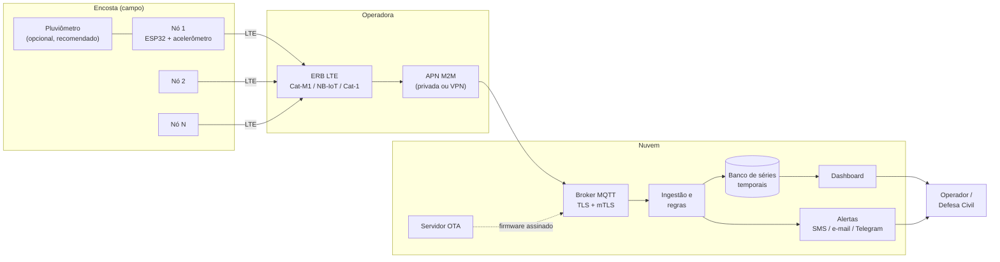
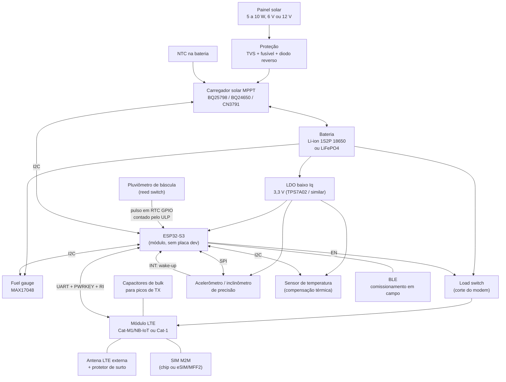
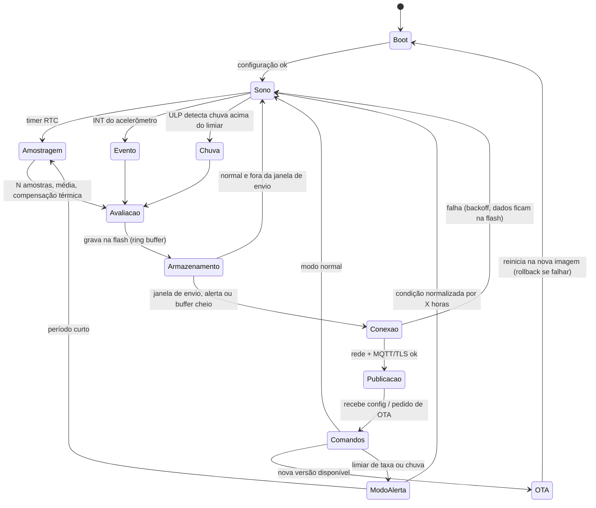
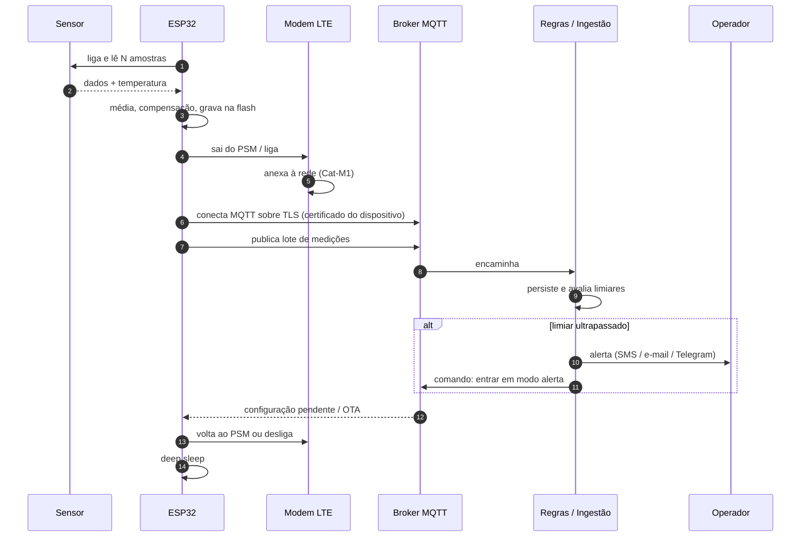
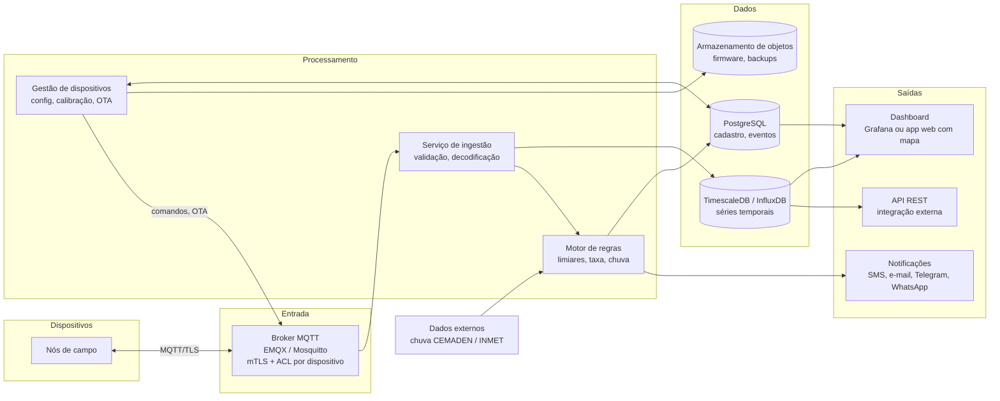
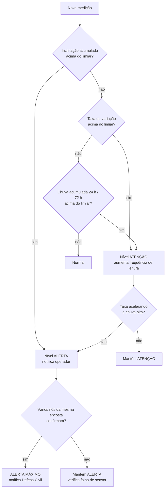

# Prospecção: sistema de monitoramento de encostas

Documento de prospecção (outubro de 2026). Objetivo: visão geral de um sistema de monitoramento de encostas com nós de campo autônomos (ESP32, acelerômetro, bateria de lítio, painel solar, 4G LTE) e uma plataforma em nuvem para armazenamento, visualização e alerta. Valores de preço e consumo são aproximados e servem para ordem de grandeza; confirmar em datasheet e cotação antes de fechar a BOM.

## 1. Visão geral

Cada nó de campo é fixado na encosta e mede a inclinação (tilt) da sua base ao longo do tempo. O acelerômetro funciona aqui como inclinômetro: o que interessa é a direção do vetor gravidade e como ela muda em horas, dias e semanas, não vibração. Movimentos de massa costumam se anunciar com aceleração da taxa de deformação, então o sistema precisa medir com estabilidade de longo prazo e reportar mais rápido quando a taxa sobe ou quando chove.

Ponto que precisa ficar claro desde a v1: um sensor de inclinação na superfície mede a rotação do ponto onde ele está ancorado. O padrão geotécnico para deslocamento em profundidade é o inclinômetro em tubo (cadeia de sensores in-place dentro de furo de sondagem), que custa uma ordem de grandeza a mais. O nó proposto aqui é um tiltmeter de superfície de baixo custo, útil para detectar movimento de blocos, muros, postes e da camada superficial, e para formar uma malha densa. A qualidade da medição depende tanto da ancoragem mecânica quanto do sensor (ver seção 7).

## 2. Hardware do nó de campo

### 2.1 Opções de acelerômetro

Para inclinação, o que manda é ruído em baixa frequência e, principalmente, estabilidade de offset com temperatura e com o tempo. Ruído branco se resolve com média de muitas amostras; deriva de offset não. Como referência, 1 mg corresponde a cerca de 0,057° de inclinação, e um tiltmeter de encosta útil precisa enxergar variações da ordem de 0,01° (cerca de 0,17 mg) de forma estável ao longo de meses, o que exclui os acelerômetros de consumo comuns.

| Sensor               | Fabricante     | Eixos | Faixa                          | Ruído (aprox.)   | Destaque                                                                                            | Consumo (aprox.) | Interface | Preço unit. (aprox.) |
| -------------------- | -------------- | ----- | ------------------------------ | ---------------- | --------------------------------------------------------------------------------------------------- | ---------------- | --------- | -------------------- |
| **SCL3300**          | Murata         | 3     | modos de inclinômetro até ±90° | ~0,001 °/√Hz     | Projetado como inclinômetro, ótima estabilidade de offset, saída de ângulo direta, robusto a choque | ~1,2 mA ativo    | SPI       | US$ 20 a 30          |
| **IIS2ICLX**         | ST             | 2     | ±0,5 / 1 / 2 / 3 g             | ~15 µg/√Hz       | Linha industrial para monitoramento estrutural, baixa deriva térmica, FIFO e machine learning core  | ~0,5 mA ativo    | SPI / I2C | US$ 15 a 20          |
| **ADXL355**          | Analog Devices | 3     | ±2 / 4 / 8 g                   | ~25 µg/√Hz       | 20 bits, baixo ruído e baixa deriva, também serve para vibração                                     | ~0,2 mA ativo    | SPI / I2C | US$ 35 a 45          |
| **ADXL362**          | Analog Devices | 3     | ±2 / 4 / 8 g                   | ~175 µg/√Hz      | Ultra baixo consumo, wake-up por movimento em centenas de nA                                        | ~2 µA a 100 Hz   | SPI       | US$ 5 a 8            |
| LIS2DW12 / LIS2DUX12 | ST             | 3     | ±2 a ±16 g                     | ~90 a 200 µg/√Hz | Barato, baixo consumo, bom para detecção de evento                                                  | µA               | SPI / I2C | US$ 1 a 3            |
| ADXL345 / MPU6050    | ADI / TDK      | 3     | ±2 a ±16 g                     | alto             | Deriva de offset alta, MPU6050 em fim de vida                                                       | mA               | I2C       | < US$ 3              |

Recomendação:

- **Sensor principal: Murata SCL3300 ou ST IIS2ICLX.** Os dois foram feitos para inclinação estável. O SCL3300 tem 3 eixos (instalação em qualquer orientação, detecção de tombamento) e histórico forte em monitoramento estrutural. O IIS2ICLX tem 2 eixos, consome menos e é mais barato, mas exige montagem com o plano XY próximo da horizontal. Para a v1, colocar footprint para os dois na mesma placa de teste e comparar em bancada térmica antes de decidir.
- **ADXL355** se além de tilt houver interesse em vibração (detecção de queda de blocos, sismo local). É o mais caro e tem deriva um pouco pior que os dedicados a inclinômetro.
- **ADXL362 como sensor auxiliar de wake-up** (opcional). Fica ligado o tempo todo a ~1 µA e acorda o ESP32 se houver choque ou movimento brusco, o que permite reportar eventos rápidos sem manter o sensor de precisão ligado. Custa pouco e simplifica a lógica de evento.
- **Não usar** ADXL345, MPU6050 ou similares de consumo como sensor de inclinação: a deriva térmica de offset é maior que o sinal que se quer medir.

Em qualquer opção, incluir um sensor de temperatura junto ao acelerômetro (ou usar o interno dele) e prever calibração térmica por unidade: o ciclo dia/noite dentro de uma caixa ao sol passa de 40 °C de amplitude e gera um falso tilt diário se não for compensado. Sensores geotécnicos dedicados (eletrolíticos ou servo-acelerômetros de fabricantes como Geokon e RST) são a referência de comparação para validar o nó em campo.

### 2.2 Microcontrolador

ESP32-S3 em módulo (ex.: ESP32-S3-WROOM-1), alimentado por LDO de baixo Iq, sem conversor USB-serial nem LED de alimentação permanentes. Placas de desenvolvimento não servem para medição de consumo: o LDO e o USB-UART delas consomem mais que o sistema inteiro em sono. Pontos relevantes:

- Deep sleep na casa de 10 µA no chip; o consumo real em sono será dominado por LDO, carregador, modem em PSM e divisores resistivos.
- O coprocessador ULP pode contar pulsos do pluviômetro e ler o sensor em sono, evitando acordar os núcleos principais a cada báscula.
- RAM suficiente para PPP + lwIP + mbedTLS, o que permite fazer TLS no ESP32 em vez de no modem (ver 3.2).
- BLE para comissionamento em campo pelo celular: ver leitura do sensor ao vivo, nivelar na instalação, configurar APN e intervalo, sem abrir a caixa.
- ESP32-C6 ou C3 são alternativas de custo menor se a RAM for suficiente; o S3 dá margem na v1.

### 2.3 Módulo LTE

A escolha da categoria LTE pesa mais que a do modelo:

| Categoria | Consumo | Cobertura no Brasil | Observação |
| --- | --- | --- | --- |
| **LTE Cat-M1 (LTE-M)** | baixo, suporta PSM e eDRX | crescente nas grandes operadoras, irregular em área rural | Melhor equilíbrio para telemetria; boa penetração |
| **NB-IoT** | o menor | irregular, depende da operadora | Latência alta, sem handover; bom para dado esparso |
| **LTE Cat-1 / Cat-1 bis** | médio (picos maiores, sem PSM em muitos módulos) | usa a rede LTE comum, cobertura mais ampla | Opção segura onde não há Cat-M |
| Cat-4 | alto | ampla | Excesso para alguns KB por hora |

Módulos candidatos:

| Módulo | Categoria | Destaque |
| --- | --- | --- |
| **Quectel BG95-M3** | Cat-M1 / NB-IoT / EGPRS | Fallback para 2G, GNSS integrado (geolocalização na instalação), muito usado no Brasil |
| **SIMCom SIM7080G** | Cat-M1 / NB-IoT | Barato, faixa de VBAT ampla (aceita LiFePO4 direto) |
| **SIMCom A7670SA** | Cat-1 (variante América do Sul) | Cobertura LTE comum, custo baixo |
| **Quectel EG915U / EC200U** | Cat-1 | Alternativa Cat-1 da Quectel |
| Nordic nRF9151 | Cat-M1 / NB-IoT | Tem MCU próprio; poderia substituir o ESP32, mas foge da plataforma que já se usa |

Recomendação: **Quectel BG95-M3** (Cat-M1 com fallback) como primeira opção e **A7670SA** (Cat-1) como plano B, com footprint compatível ou placa-filha. Antes de fechar, fazer levantamento de cobertura em cada local com um módulo de teste e SIM de mais de uma operadora; encosta em vale frequentemente tem sinal pior que o mapa da operadora indica. Para cobertura, considerar SIM M2M multioperadora (roaming nacional permanente). Usar módulo já homologado na ANATEL evita certificação de rádio do produto.

Cuidados de projeto: o modem tem picos de corrente de centenas de mA (Cat-M) a cerca de 2 A (2G), então alimentar direto da bateria com capacitores de bulk e trilha larga, nunca pelo LDO de 3,3 V do ESP32. Load switch para cortar o modem quando PSM não for confiável, e controle por PWRKEY/RESET para recuperar o modem travado.

### 2.4 Energia

- **Bateria:** Li-ion 18650 em 1S2P (cerca de 6 Ah) atende a v1. A restrição real é temperatura: Li-ion não pode carregar abaixo de 0 °C e degrada rápido acima de 45 °C, e uma caixa ao sol passa disso. O carregador precisa de NTC na bateria com perfil JEITA. LiFePO4 tolera melhor temperatura, é mais segura e tem mais ciclos, mas a tensão nominal de 3,2 V fica no limite inferior de VBAT de alguns modems (o BG95 pede 3,3 V mínimo; o SIM7080G aceita). Avaliar com o modem escolhido.
- **Carregador:** BQ25798 (buck-boost, MPPT, I2C, NTC/JEITA, telemetria de tensão e corrente) é a opção mais completa. BQ24650 (MPPT por tensão, standalone) e CN3791 (barato) são alternativas mais simples.
- **Fuel gauge:** MAX17048 (poucos µA) para reportar estado de carga na telemetria e permitir que o firmware reduza a taxa de envio quando a bateria baixa.
- **Proteção:** TVS e fusível na entrada do painel, proteção de inversão, TVS na antena e no cabo do pluviômetro, aterramento da haste. Descarga atmosférica é a causa mais comum de perda de equipamento em campo.

### 2.5 Orçamento de energia (estimativa)

| Item | Premissa | Carga diária (Cat-M1) | Carga diária (Cat-1) |
| --- | --- | --- | --- |
| Sono do sistema | ~100 µA reais (MCU, LDO, carregador, modem em PSM) | 2,4 mAh | 2,4 mAh (modem cortado) |
| Amostragem | a cada 10 min, ~1 s a 30 mA | 1,2 mAh | 1,2 mAh |
| Transmissão | a cada 1 h, ~20 s a 150 mA (Cat-M) ou ~30 s a 250 mA (Cat-1, com registro na rede) | 20 mAh | 50 mAh |
| **Total modo normal** | | **~25 mAh/dia** | **~55 mAh/dia** |
| Modo alerta | modem conectado (eDRX), envio a cada 1 a 5 min | 300 a 600 mAh/dia | 800 a 1500 mAh/dia |

Com 6 Ah e 80% utilizáveis, o modo normal dá de 2 a 6 meses sem sol; o modo alerta, poucos dias. O dimensionamento do painel deve partir do modo alerta em período chuvoso (que é justamente quando há menos sol): um painel de 5 a 10 W com 6 Ah de bateria dá folga. O consumo real precisa ser medido no protótipo com analisador de energia (ex.: Nordic PPK2 ou Joulescope), principalmente o tempo de registro na rede, que varia muito com o sinal.

## 3. Firmware

### 3.1 Ciclo de operação

Funções principais:

- **Medição:** liga o sensor, descarta as primeiras amostras, faz média de centenas de leituras (reduz ruído branco), aplica calibração por unidade (offset, ganho, temperatura) e calcula ângulos nos dois eixos de interesse.
- **Detecção local:** compara inclinação acumulada e taxa de variação (graus por hora/dia) com limiares configuráveis pela nuvem; ao passar, entra em modo alerta e envia na hora, sem esperar a janela.
- **Store-and-forward:** toda medição vai para um ring buffer na flash com timestamp; envio em lote quando houver rede. Sem cobertura por dias, nada se perde até o limite do buffer.
- **Relógio:** sincroniza hora pela rede (NITZ do modem ou SNTP) a cada conexão; timestamps em UTC.
- **Robustez:** watchdog de tarefa e de hardware, recuperação do modem por PWRKEY e corte de energia, contadores de reset e de falha de conexão enviados na telemetria.
- **OTA:** `esp_https_ota` com partições A/B e rollback automático se a nova imagem não conectar e confirmar.

### 3.2 Comunicação

- **Protocolo:** MQTT sobre TLS 1.2/1.3 com autenticação mútua (certificado X.509 por dispositivo). Sessão persistente e QoS 1 para garantir entrega dos lotes.
- **Onde roda a pilha IP:** recomendo PPP com o componente `esp_modem` do ESP-IDF, de forma que lwIP e mbedTLS rodem no ESP32. Custa mais RAM e um pouco mais de energia que usar a pilha TCP/TLS interna do modem por comandos AT, mas deixa as chaves e a validação de certificado sob controle do firmware, independe do fabricante do modem e facilita trocar de módulo. A alternativa por AT é mais leve, porém amarra o firmware a cada modem e a implementação de TLS do modem costuma ser limitada.
- **Payload:** CBOR ou Protobuf, ou JSON compacto na v1. Cada lote horário fica em centenas de bytes; o custo dominante é o handshake TLS (alguns KB), reduzido com retomada de sessão. Estimativa: 5 a 15 MB por mês por nó em modo normal, o que cabe em plano M2M barato.
- **Alternativa para NB-IoT:** LwM2M/CoAP sobre DTLS tem overhead bem menor e é o padrão para NB-IoT; vale considerar se a cobertura obrigar NB-IoT.

## 4. Nuvem

Três caminhos possíveis, do mais rápido ao mais controlado:

| Opção | Componentes | Prós | Contras |
| --- | --- | --- | --- |
| **Plataforma IoT pronta (open source)** | ThingsBoard CE em VPS | Broker, banco, dashboard, regras, cadastro de dispositivos e OTA prontos; v1 em dias | Customização de UI e lógica limitada; escala exige versão paga ou cluster |
| **Stack própria em VPS** | EMQX ou Mosquitto + serviço de ingestão (Python/Go) + TimescaleDB + Grafana | Controle total, custo baixo, sem lock-in | Mais código e operação (backup, atualização, monitoramento) |
| **Nuvem gerenciada** | AWS IoT Core ou Azure IoT Hub + banco gerenciado + funções serverless | Provisionamento de certificados e escala resolvidos, alta disponibilidade | Custo por mensagem, lock-in, curva de aprendizado; o Google Cloud IoT Core já foi descontinuado, o que mostra o risco |

Recomendação para a prospecção: **ThingsBoard CE** para validar o produto rapidamente, com o firmware falando MQTT padrão para que a migração para uma stack própria (EMQX + TimescaleDB + Grafana) seja só troca de servidor. Se a TechFab já tiver plataforma IoT interna em produção, avaliar reuso antes de subir algo novo.

### 4.1 Lógica de alerta

Regras práticas: limiares por nó (cada ponto tem comportamento próprio, calibrar com semanas de linha de base), filtros contra falso positivo (vibração, dilatação térmica, sensor solto), confirmação cruzada entre nós da mesma encosta, e alerta de saúde do equipamento (bateria baixa, nó sem reportar, sensor fora de faixa) separado do alerta geotécnico. Para previsão de ruptura, o método da velocidade inversa (Fukuzono) é a referência simples quando há fase de aceleração. Os níveis devem ser definidos com o geotécnico responsável e alinhados ao protocolo da Defesa Civil local; o sistema apoia a decisão, não a substitui.

## 5. Segurança

Um sistema que dispara alerta para evacuação não pode aceitar dado forjado nem ficar mudo por ataque. Itens mínimos já na v1:

- **Identidade por dispositivo:** certificado X.509 e chave privada únicos por nó, gerados na produção; nada de senha MQTT compartilhada no firmware. ACL no broker restringindo cada nó ao próprio tópico.
- **Firmware:** Secure Boot v2 e criptografia de flash do ESP32, imagens OTA assinadas, rollback anti-downgrade. Isso protege as credenciais se alguém roubar um nó em campo, o que é provável.
- **Rede:** APN privada ou VPN da operadora, nós sem IP público e sem porta aberta; TLS mesmo dentro da APN.
- **BLE de comissionamento:** pareamento autenticado e ativo só por janela curta após ação física (ímã/reed ou botão interno), nunca permanentemente anunciando com acesso de escrita.
- **Nuvem:** autenticação forte no dashboard, registro de auditoria de mudanças de limiar e de comandos enviados, backups testados.
- **Disponibilidade:** monitoramento de "nó silencioso" (falta de dado é um evento), e servidor de alerta com redundância ou ao menos monitoramento externo.

## 6. Instalação em campo

- **Ancoragem:** haste metálica cravada ou chumbada em concreto abaixo da camada superficial, com o sensor fixado rigidamente no topo. Sensor solto na caixa mede a caixa, não a encosta.
- **Caixa:** IP67, com respiro (membrana de equalização) para evitar condensação, de cor clara e com sombreamento para reduzir variação térmica.
- **Painel:** voltado para o norte com inclinação próxima à latitude local, fora de sombra de vegetação, à prova de furto.
- **Pluviômetro:** a chuva é o principal gatilho de deslizamento no Brasil. Mesmo que nem todo nó tenha, ter ao menos um por encosta (ou integrar dados do CEMADEN) melhora muito a qualidade do alerta.
- **Georreferenciamento:** registrar posição e orientação de cada nó na instalação (GNSS do BG95 resolve a posição, não serve para medir deslocamento).

## 7. Evolução possível

- **GNSS RTK de baixo custo** (ex.: u-blox ZED-F9P) em alguns nós para deslocamento absoluto em centímetros, complementar ao tilt.
- **Cadeia de sensores em profundidade** (vários MEMS em tubo, barramento RS-485) para um inclinômetro in-place de baixo custo.
- **Umidade do solo e poropressão** (piezômetro), que respondem antes do movimento.
- **Rede local LoRa** entre nós de uma mesma encosta com um único gateway LTE, reduzindo custo de SIM e consumo quando houver muitos pontos próximos.

## 8. Estimativa de custo do nó (v1, eletrônica)

| Item | Faixa (US$) |
| --- | --- |
| ESP32-S3 (módulo) | 3 a 5 |
| Acelerômetro de precisão (SCL3300 / IIS2ICLX) | 15 a 30 |
| Módulo LTE (BG95-M3 / A7670SA) | 10 a 20 |
| Carregador MPPT + fuel gauge + LDO + proteções | 8 a 15 |
| Baterias (2× 18650) | 8 a 15 |
| Painel solar 5 a 10 W | 15 a 30 |
| Antena LTE externa + protetor de surto | 8 a 20 |
| PCB, passivos, conectores | 10 a 20 |
| Caixa IP67, prensa-cabos, haste e fixação | 20 a 50 |
| **Total aproximado** | **100 a 200** |

Sem contar pluviômetro (US$ 30 a 150), SIM M2M (mensalidade) e infraestrutura de nuvem (uma VPS de US$ 10 a 40 por mês atende dezenas a centenas de nós na v1).

## 9. Próximos passos sugeridos

1. Levantamento de cobertura LTE (Cat-M1 e Cat-1, mais de uma operadora) nos locais candidatos.
2. Placa de avaliação com SCL3300 e IIS2ICLX lado a lado, ensaio em câmara térmica e em mesa de nivelamento para medir deriva real.
3. Protótipo do nó com BG95-M3, medição de consumo com analisador de energia e validação do orçamento de energia.
4. Firmware mínimo: amostragem, store-and-forward, MQTT/TLS via PPP, OTA com rollback.
5. ThingsBoard CE em VPS com dashboard, regras de limiar e notificação.
6. Instalação piloto em 2 a 3 pontos com acompanhamento de um geotécnico, incluindo ao menos um ponto com referência independente (topografia ou inclinômetro convencional) para validar as leituras.
